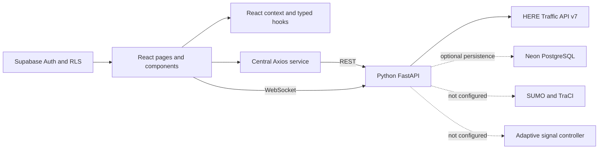

# SmartFlow AI Frontend Architecture

## Overview

The frontend is a React + TypeScript + Vite application for the SmartFlow AI traffic operations platform. The FastAPI service provides existing simulation/demo contracts plus on-demand
HERE Traffic API v7 data. Supabase Auth and user preferences are enabled when
public browser configuration and the corresponding database migration are
available.

## Architecture

## Component Architecture

- `components/layout` contains the application sidebar, top navigation, and main shell.
- `components/common` contains reusable buttons, cards, badges, states, and page headers.
- `pages` contains route-level views.
- Traffic, chart, AI, and emergency folders are reserved for future feature components.

## Routing

React Router owns application navigation. Public routes include `/`, `/login`, and `/signup`. Operations routes live under `/dashboard`, `/simulation`, `/ai-control`, `/emergency`, `/heatmap`, `/prediction`, `/analytics`, `/history`, and `/settings`. Unknown paths show a 404 route.

## API Integration

`src/services/api.ts` is the single Axios integration surface. It validates and unwraps the backend envelope. Typed contracts live in `src/types/api.ts`, while shared status and error types live in `src/types/common.ts`. Frontend configuration uses `VITE_API_URL`. Request timeout, network, HTTP, and invalid-response errors are converted to a consistent `ApiResult` shape. The top navigation checks API health and displays actual simulation availability separately from the local demo state.

## State Management

React context is used for global theme and local demo simulation state. React Router owns route state. Backend health and simulation availability are read once by the top navigation; feature-level server state should use typed service methods.

## Authentication

Supabase Auth is initialized only when `VITE_SUPABASE_URL` and
`VITE_SUPABASE_ANON_KEY` are set. The anonymous key is public and all user
preference operations rely on PostgreSQL RLS. Signup, login, reset, and logout
use Supabase Auth. Profiles are read only by their owner. Server service-role
credentials and the Neon `DATABASE_URL` are never included in the frontend.

## Live traffic

The dashboard and heatmap request `GET /api/traffic/live` on page load and
explicit refresh. HERE flow geometries and speeds, jam factor, provider source
timestamps, and incident records are rendered from provider responses only.
Missing fields remain unavailable; the provider does not supply vehicle counts
or queue lengths in this integration. The attached traffic workbook is
documented by its own `Read_Me` sheet as synthetic and is displayed only as a
separately labeled demonstration sample.

## WebSocket Integration

`src/services/websocket.ts` creates `WS /ws/simulation/{run_id}` connections. URL construction uses `ws:` for HTTP API URLs and `wss:` for HTTPS API URLs. The backend currently sends only an inactive status for valid UUID run IDs; there are no live updates.

## Scalability

Routes and components are feature-oriented. API contracts are isolated from UI code. Environment variables are centralized for deployment portability.
